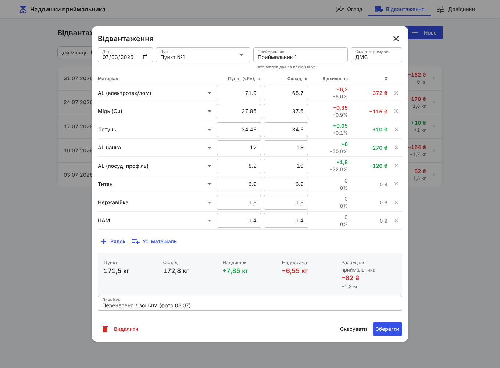
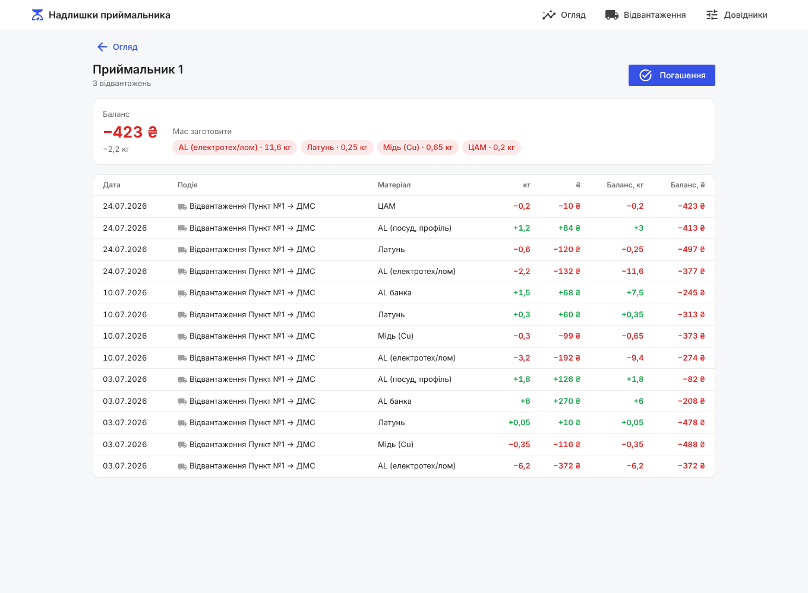

# Надлишки приймальника

Облік відхилень ваги між **пунктом приймання** і **складом** (напр. склад кольорового «ДМС»)
після кожного відвантаження. Замінює ручну табличку в зошиті / Excel.

## Як рахується

На кожне відвантаження вносяться дві колонки, як у зошиті:

| Матеріал | Пункт («Я»), кг | Склад (ДМС), кг | Відхилення |
|---|---|---|---|
| AL | 71,9 | 65,7 | **−6,2** — недостача |
| AL банка | 12 | 18 | **+6** — надлишок |

* **Відхилення = склад − пункт.**
* **«−» (недостача)** — приймальник поставив засор замалий: за обліком пункту вага є, а фізично її нема.
  Цю вагу він має **заготовити**.
* **«+» (надлишок)** — засор поставлено більший, ніж треба.
* Плюси й мінуси — це **особистий баланс приймальника**, окремо по кожному матеріалу (кг)
  і в грошах (кг × ціна матеріалу на момент відвантаження).
* Гроші важливі окремо від ваги: 03.07 по вазі вийшло **+1,3 кг**, а в грошах **мінус** —
  дорогий AL пересортували в дешевшу банку/посуд.
* **Погашення** — запис «заготовив недостачу» або «списали надлишок»; зменшує борг по матеріалу.
  Баланс приймальника рахується за всю історію (борг не «згорає» з новим місяцем).

## Що є в програмі

* **Огляд** — за період: надлишок, недостача, разом у ₴; графік відхилення після кожного
  відвантаження; баланс кожного приймальника з розкладкою по матеріалах і кнопкою
  «Заготовив/Списати»; зведення по матеріалах (кг, %, ₴); вивантаження в Excel.
* **Відвантаження** — внесення сторінки «як у зошиті» з живим підрахунком відхилень.
* **Приймальник** — хронологія відхилень і погашень з наростаючим балансом.
* **Довідники** — пункти й приймальники, матеріали й ціни (₴/кг).

Ціни в стартових даних **орієнтовні** — поставте свої в «Довідниках». У вже збережених
відвантаженнях ціна зафіксована знімком.

## Запуск

```bash
pip install -r requirements.txt
cd vue-app && npm install && npm run build && cd ..
uvicorn main:app --port 8000
```

Відкрити `http://localhost:8000/app/`. API-документація — `/api/docs`.
Під час першого старту створюються довідники, сторінка з зошита за 03.07 і кілька
демо-відвантажень (`IZLISHEK_SEED_DEMO=0` — без них). База — `izlishek.db`
(`IZLISHEK_DB_URL` — інша, напр. PostgreSQL через `postgresql+asyncpg://…`).

Тести: `pytest`.

## Перенесення в Gobsek

Код навмисно складено як модуль Gobsek: `app/modules/surplus/` (models / schemas / service /
router), FastAPI + SQLAlchemy 2.0 async, Vue 3 + Quasar, токени `--mg-*`. Для перенесення:
скопіювати модуль, підʼєднати пункти до `facilities`, матеріали — до `products`, додати
`CurrentUser`/`require_roles` на ендпоінти й міграцію Alembic. Тут авторизації немає —
не виставляйте без неї в інтернет.

## Скріншоти




