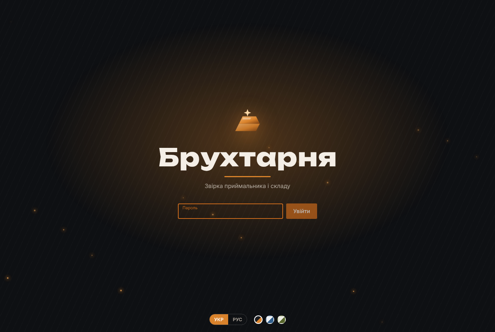
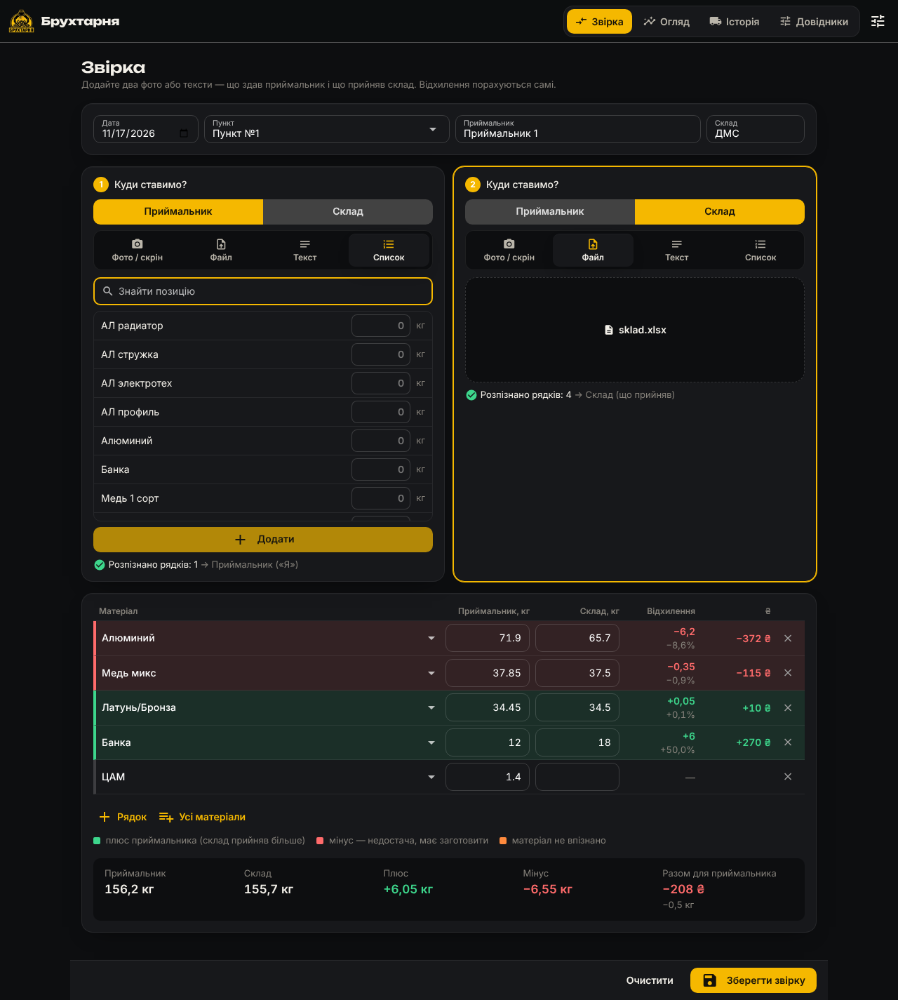
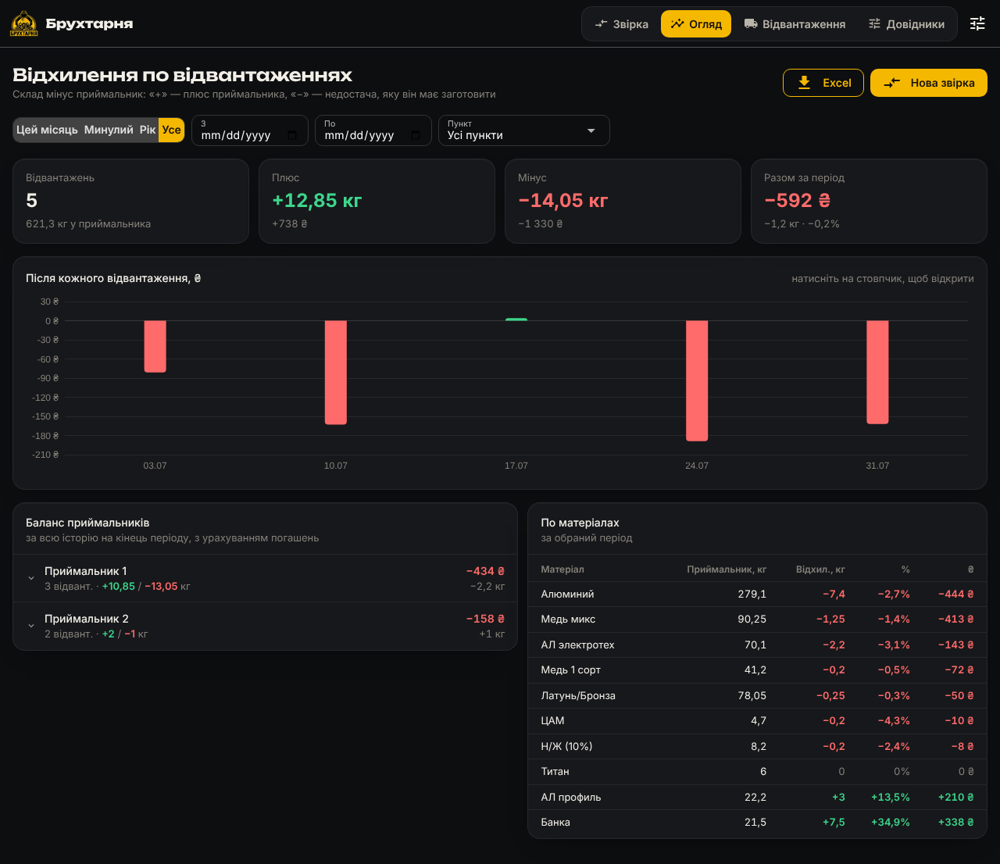
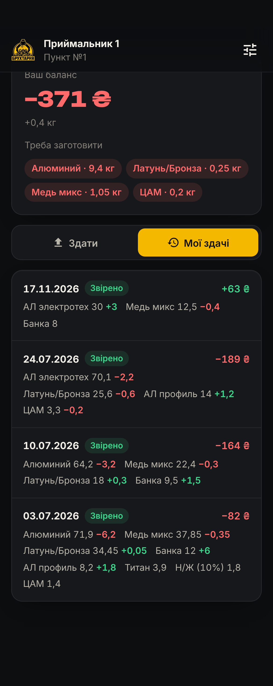
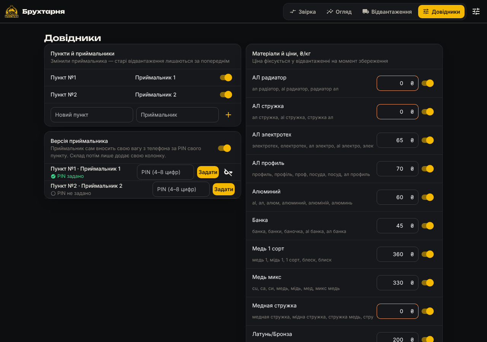

# Брухтарня

Звірка приймальника і складу: надлишки й недостачі по кольоровому брухту.

Облік відхилень ваги між **пунктом приймання** і **складом** (напр. склад кольорового «ДМС»)
після кожного відвантаження. Замінює ручну табличку в зошиті / Excel.

## Як рахується

На кожне відвантаження вносяться дві колонки, як у зошиті:

| Матеріал | Пункт («Я»), кг | Склад (ДМС), кг | Відхилення |
|---|---|---|---|
| AL | 71,9 | 65,7 | **−6,2** — недостача |
| AL банка | 12 | 18 | **+6** — надлишок |

* **Відхилення = склад − пункт.**
* **«−» (недостача)** — приймальник поставив засор замалий: за обліком пункту вага є, а фізично її нема.
  Цю вагу він має **заготовити**.
* **«+» (надлишок)** — засор поставлено більший, ніж треба.
* Плюси й мінуси — це **особистий баланс приймальника**, окремо по кожному матеріалу (кг)
  і в грошах (кг × ціна матеріалу на момент відвантаження).
* Гроші важливі окремо від ваги: 03.07 по вазі вийшло **+1,3 кг**, а в грошах **мінус** —
  дорогий AL пересортували в дешевшу банку/посуд.
* **Погашення** — запис «заготовив недостачу» або «списали надлишок»; зменшує борг по матеріалу.
  Баланс приймальника рахується за всю історію (борг не «згорає» з новим місяцем).

## Що є в програмі

* **Вхід** — екран з логотипом «Брухтарня», короткою фразою на день, полем пароля, вибором мови й теми.
  Адміністратор входить паролем `APP_PASSWORD`, приймальник — PIN свого пункту (якщо увімкнено його версію).
  Сесія тримається 60 днів; зміна пароля чи PIN скидає відповідні сесії. Перебір обмежено: 8 невдалих спроб за 10 хв.
* **Дві мови** — українська і російська. Сервер відповідає тією ж мовою: помилки, Excel.
* **Три теми** — «Брухтарня» (типова: чорний + жовтий з логотипа), «Сталь», «Хакі».
* **Версія приймальника** (за бажанням: «Довідники → Версія приймальника» + PIN кожному пункту).
  Приймальник із телефона фотографує/вставляє свої записи і відправляє здачу на звірку; бачить свої здачі,
  результат після звірки і свій баланс («треба заготовити»). Ваги складу до звірки не бачить і чужого не бачить.
  На екрані «Звірка» у адміністратора зʼявляється блок «Чекають звірки» — відкрив, додав вагу складу, зберіг.
  Без увімкненої версії все працює як раніше: усе вносить адміністратор.
* **Звірка** — головний екран. Дві колонки: що здав приймальник і що прийняв склад.
  Для кожної обираєте, куди ставимо («Приймальник» / «Склад»), і спосіб введення:
  **Фото** (фото чи скрін), **Файл** (Excel, CSV, TXT, PDF), **Текст** (як зручно — у рядок,
  через кому чи з нового рядка: «AL 71,9 Cu 37,85 Банка 12») або **Список** (усі позиції,
  біля кожної — поле ваги). Якщо на фото/у файлі дві колонки, одне джерело заповнює обидві.
  Рядки підсвічуються: зелений — плюс приймальника, червоний — мінус (має заготовити),
  помаранчевий — матеріал не впізнано. На компʼютері можна вставити скрін через Ctrl+V або перетягнути файл.
* **Історія** — усі збережені звірки; відкрити, виправити, видалити.
* **Огляд** — за період: надлишок, недостача, разом у ₴; графік відхилення після кожного
  відвантаження; баланс кожного приймальника з розкладкою по матеріалах і кнопкою
  «Заготовив/Списати»; зведення по матеріалах (кг, %, ₴); вивантаження в Excel.
* **Відвантаження** — внесення сторінки «як у зошиті» з живим підрахунком відхилень.
* **Приймальник** — хронологія відхилень і погашень з наростаючим балансом.
* **Довідники** — пункти й приймальники, матеріали й ціни (₴/кг).

Матеріали — позиції «кольоровий лом» з WebMax (29 шт.). **Ціни не задані** — поставте свої
в «Довідниках»: поки ціни нема, поле підсвічене, а звірка пише, що ці позиції в гроші не пораховано.
У вже збережених відвантаженнях ціна зафіксована знімком.

## Розпізнавання

* **Текст** розбирається на сервері миттєво: рядок «назва вага [вага2]», кома чи крапка —
  неважливо. Назви зіставляються з довідником за «як пишуть» (Довідники → матеріал):
  `al, ал, алюміній`, `cu, са, мідь`, `банка` тощо. Найдовший збіг виграє: «AL банка» — це банка.
* **Фото** розпізнає Claude (модель `claude-opus-5-5`, змінна `IZLISHEK_VISION_MODEL`).
  Потрібен `ANTHROPIC_API_KEY`. Фото стискаються в браузері до ~1600 px перед відправкою.

## Розгортання на Render

1. На render.com: **New → Blueprint** → вибрати цей репозиторій (гілку). Render прочитає
   `render.yaml` і створить вебсервіс (Docker) + базу PostgreSQL.
2. Під час створення попросить `ANTHROPIC_API_KEY` — ключ із console.anthropic.com
   (без нього працює все, крім фото).
3. Пароль на вхід згенерується сам: сервіс → **Environment → APP_PASSWORD**
   (можна замінити на свій).

⚠ На безкоштовному плані база видаляється через 30 днів, а сервіс засинає після 15 хв
без запитів (перше відкриття ~50 с). Для щоденної роботи — план `starter` для сервісу
і `basic` для бази.

## Запуск локально

```bash
pip install -r requirements.txt
cd vue-app && npm install && npm run build && cd ..
uvicorn main:app --port 8000
```

Відкрити `http://localhost:8000/app/`. API-документація — `/api/docs`.
Під час першого старту створюються довідники, сторінка з зошита за 03.07 і кілька
демо-відвантажень (`IZLISHEK_SEED_DEMO=0` — без них). База — `izlishek.db`
(`IZLISHEK_DB_URL` — інша, напр. PostgreSQL через `postgresql+asyncpg://…`).

Тести: `pytest`.

## Перенесення в Gobsek

Код навмисно складено як модуль Gobsek: `app/modules/surplus/` (models / schemas / service /
router), FastAPI + SQLAlchemy 2.0 async, Vue 3 + Quasar, токени `--mg-*`. Для перенесення:
скопіювати модуль, підʼєднати пункти до `facilities`, матеріали — до `products`, додати
`CurrentUser`/`require_roles` на ендпоінти й міграцію Alembic. Зараз захист — один спільний
пароль (`APP_PASSWORD`).

## Скріншоти






